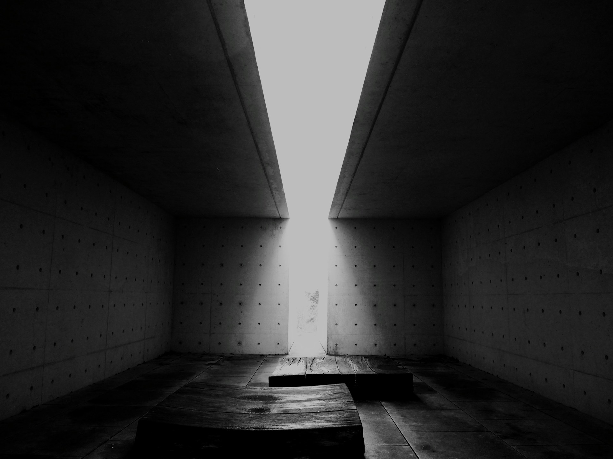

# STILLFORM — Hero asset shortlist

**Phase 02B · Verified 25 October 2026**

Three actual photographs were visually inspected on their individual Unsplash pages. Each page explicitly displayed **free use under the Unsplash License**, not Unsplash+. Original dimensions below came from the page's download-size menu; local study dimensions were checked from the downloaded JPEG files.

**Preferred candidate: 1, E Vos.** Both Hero variants use this same photograph so the comparison tests composition rather than different subject matter. The other two are genuine alternatives, not assets silently substituted into the proofs.

## 1. Tulach a’ tSolais — E Vos

[Photograph/source page](https://unsplash.com/photos/dark-concrete-hallway-with-bright-light-at-the-end-ela0A8rSxbw) · [photographer](https://unsplash.com/@ecvirl) · [direct image used in the study](https://images.unsplash.com/photo-1766322088147-2dae20085266?fm=jpg&q=88&w=1920&fit=max) · [local study image](proofs/assets/tulach-e-vos.jpg)

| Item | Verified information / assessment |
| --- | --- |
| Attribution | **E Vos**, account **@ecvirl**. Use that credited name; a fuller legal name was not established. |
| Architecture | The photographer's source description identifies **Tulach a’ tSolais**, County Wexford, Ireland. **Scott Tallon Walker** lists the memorial in its [official project index](https://stwarchitects.azurewebsites.net/projects/list). Individual architect/sculptor credits were not independently resolved from the fully accessed project page; do not invent or omit that future metadata task. |
| Available original | **4242 × 3181**, approximately **1.3335:1**, almost 4:3. Original resolution is the offered download size, not the file bundled here. |
| Local study copy | **1920 × 1440**, JPEG, **236,795 bytes**. Unfiltered; only CDN resizing/compression and CSS cropping. |
| License | The specific photo page states Unsplash License. Its [published terms](https://unsplash.com/license) permit downloading, modifying and using covered photographs, including commercial use, without individual photographer permission. Attribution is retained in the proofs. |
| Desktop crop | A uses a **1368 × 624** landscape frame: retains the light shaft but deliberately loses roof/floor context. B uses approximately **641 × 665**, centered: the vertical opening and floor sequence remain more complete. |
| Mobile crop | A uses **350 × 432**; B uses **290 × 420** with its lower edge partly covered by the title field. Center on the light shaft; do not crop off its point of constriction. |
| Artistic advantage | Two concrete masses make the void unmistakable. The original monochrome treatment works with the mineral palette and leaves a dark side plane for B's chalk letter intersection. |
| Limitation | Some highlights are already very bright and shadows deep. Do not add contrast or simulate detail. A wide crop loses context; the subject is a memorial and should retain its real name and attribution, rather than become anonymous “brutalism.” |

**Assessment:** strongest fit for the Hero and the proposed two-panel editorial transition. Its reuse basis is the photographer's licensed Unsplash upload, **not** any institutional photograph from the earlier board.

## 2. Setre Marina Lake Biwako passage — Anastashia Nadya Angkasa

[Photograph/source page](https://unsplash.com/photos/modern-architectural-passage-with-sunlight-and-shadows-XnAubvnRnYU) · [photographer](https://unsplash.com/@nadyangkasa) · [direct study image](https://images.unsplash.com/photo-1773549760309-9ed383225d68?fm=jpg&q=85&w=1600&fit=max) · [local study image](proofs/assets/passage-anastashia-angkasa.jpg)

| Item | Verified information / assessment |
| --- | --- |
| Attribution | **Anastashia Nadya Angkasa**, **@nadyangkasa**. |
| Architecture | The photo page identifies **Setre Marina Lake Biwako, Moriyama, Shiga, Japan**. The hotel's [official architectural article](https://journey.hotelsetre.com/architecturaldesign-1869/) credits **Ryuichi Ashizawa**. The exact passage's designation is not asserted beyond the photographer's location. |
| Available original | **2652 × 3991**, approximately **0.6645:1**, close to 2:3 portrait. |
| Local study copy | **1600 × 2408**, JPEG, **312,975 bytes**. |
| License | Specific photo page states free use under the [Unsplash License](https://unsplash.com/license). Photographer permission is supplied through that license; no separate commission or written permission was obtained. |
| Desktop crop | Best in a tall frame, roughly 4:5 or 3:4, beside large type. A panoramic frame would remove too much of the narrowing passage and sunlit floor. |
| Mobile crop | Native portrait is highly suitable. Preserve the central distant opening and the diagonal light on the walking surface; keep both converging walls visible. |
| Artistic advantage | An actual path through thick walls makes “around” tangible. Warm reflected light gives material depth without a UI color overlay. |
| Limitation | Less suitable for A's broad photographic field. It introduces a warmer atmosphere and is compositionally busy near the base. Text should stay outside the passage. |

**Assessment:** strongest alternative if the selected Hero should feel traversable and warmer. Viewed in the browser and downloaded for study; not used in the two final layout comparisons.

## 3. Curved concrete opening — Mattia Revelant

[Photograph/source page](https://unsplash.com/photos/curved-concrete-walls-in-park-wWFy4g4iOHs) · [photographer](https://unsplash.com/@vez02) · [direct study image](https://images.unsplash.com/photo-1787228164960-2f08d4419f9d?fm=jpg&q=85&w=1600&fit=max) · [local study image](proofs/assets/curved-mattia-revelant.jpg)

| Item | Verified information / assessment |
| --- | --- |
| Attribution | **Mattia Revelant**, **@vez02**. |
| Architecture | **Building, architect and location unresolved.** The page describes curved concrete walls and an opening toward a grassy park, but supplies no reliable building attribution. No identity is inferred from visual resemblance. |
| Available original | **4160 × 6240**, exactly **2:3 portrait**. |
| Local study copy | **1600 × 2400**, JPEG, **823,959 bytes**. |
| License | Specific photo page states free use under the [Unsplash License](https://unsplash.com/license). |
| Desktop crop | Use a tall 4:5 frame. Retain the high narrow aperture and lower doorway together; a horizontal crop would separate the two useful voids. |
| Mobile crop | Excellent resolution for a portrait frame. Slightly favor the upper-right aperture while keeping the doorway below. Final focal point needs a dedicated crop study if selected. |
| Artistic advantage | Curved material mass provides an alternative to rectilinear monumental minimalism. Board-formed texture gives the page material presence. |
| Limitation | Exterior grass, vehicles and surrounding context reduce abstraction. The unresolved building credit makes this a weaker editorial lead even though the photo's license is available. |

**Assessment:** strong material/frame study; third choice for the Hero until building attribution is resolved.

## Permission status and provenance

**The photographic reuse basis was found for all three candidates.** These are not the uncleared institutional images from Phase 02. This is a verified statement of the license displayed by each uploader's page, not a representation that independent property, artwork or other third-party rights have been exhaustively cleared. No institutional permission or endorsement is implied.

The explicit unresolved constraint is **candidate 3's architectural identity**, plus completing detailed architectural credits for the eventual selected record. Keep that distinction separate from the photo license.

No original full-resolution files, derivative crop exports, optimized production sets or generated imagery were created. The three local JPEGs are bounded **study copies**. Preserve attribution and source links when reviewing or sharing them. The standard license excludes selling images without significant modification and assembling a competing image service; STILLFORM should remain an authored editorial project, not a stock-photo download collection.

[Machine-readable provenance](proofs/assets/asset-provenance.json) records URLs, observed source dimensions, local dimensions and access notes. [Font notices and study usage](proofs/README.md) cover the actual type files.

