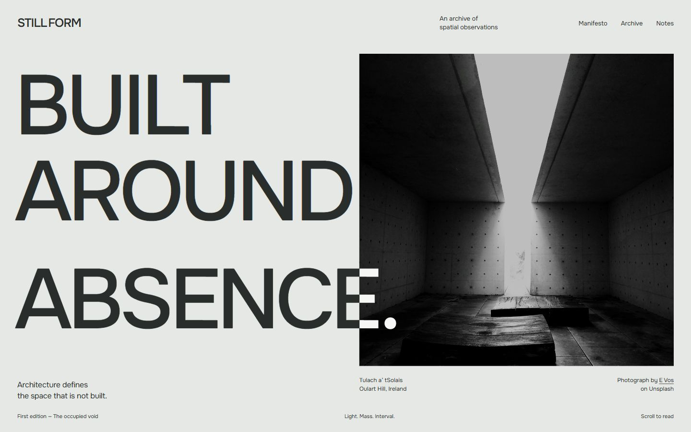
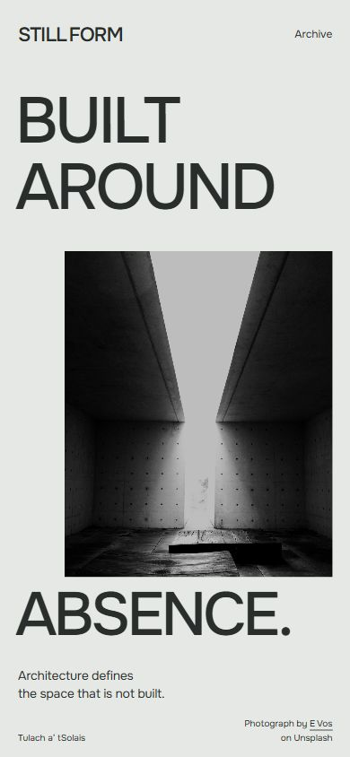
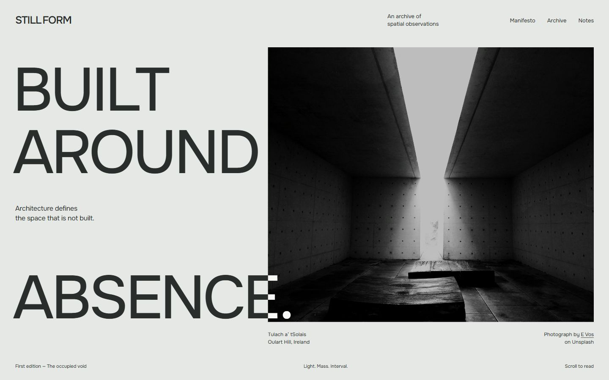
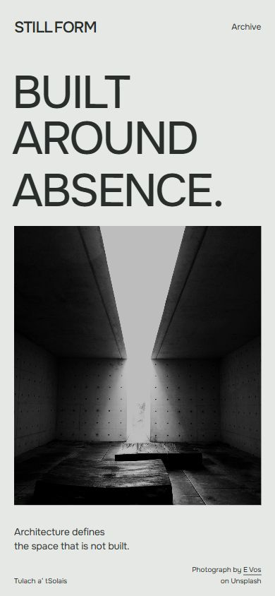

# STILLFORM — Onest Hero refinement

**Phase 02C · 25 October 2026 · Real static browser renders**

One approved direction, two focused refinements. Both use local Onest Variable, the retained mineral/graphite palette, the same **E Vos photograph of Tulach a’ tSolais**, and the exact copy **BUILT AROUND ABSENCE.** [Existing photographic attribution and license research](HERO_ASSET_SHORTLIST.md) remains the source of record.

## Study 1 — Preserve the cut

[Standalone HTML](proofs/onest/study-1.html)

Onest **500 at 176px**, with −0.055em tracking, replaces the heavier-looking irregularity of the previous mixed-case study with controlled uppercase planes. The approximately **655 × 650px** photograph begins at 52% of the viewport. AROUND stops before that edge; the ending of ABSENCE. crosses it and turns chalk. The opening in the photograph stays unobstructed. Small metadata remains quiet and aligned with the frame.

Mobile preserves the conceptual interval: BUILT / AROUND precedes a right-offset **298 × 400px** frame, then ABSENCE. overlaps its lower portion with a mineral field. Opening words are approximately 72px; the final word is approximately 68px. The photograph completes the sentence spatially. The bottom overlap is intentional cropping, not hidden accidental overflow.

**Assessment:** strongest continuity with approved The Cut; distinctive on both screens. Main tradeoff: the narrow mobile image and closing title remove some lower-floor context. The desktop intersection remains sensitive to future copy or breakpoint changes.

## Study 2 — Give the photograph room

[Standalone HTML](proofs/onest/study-2.html)

Onest **450 at 144px**, with −0.045em tracking, reduces typographic density. The photograph begins at 44% and grows to approximately **770 × 650px**, about 18% wider than study 1. The supporting sentence occupies the left interval between AROUND and ABSENCE.; the final word approaches the image's bottom edge. The larger photograph retains more of the concrete side walls and spatial depth.

Mobile consolidates the sentence above an almost full-width **350 × 395px** photograph. The approximately 65px headline is lighter and more compact. The image's opening and floor remain clear. This gives photography more uninterrupted attention, although the stacked title/image relationship is less specific to Occupied Void.

**Assessment:** stronger architectural observation and a calmer editorial reading. The large desktop interval has a purpose, but the mobile layout approaches a familiar editorial cover. It should be selected for that photographic priority, not merely because it seems safer.

## Recommendation

**Advance study 1.** It offers the best balance of impact, legibility and authored mobile composition. Onest 500 has enough authority without relying on extreme weight. Study 2 is a credible alternative if architectural photography should clearly outrank typographic expression.

| Decision | Study 1 | Study 2 |
| --- | --- | --- |
| Primary visual mass | Type and image in tension | Photograph |
| Negative space | An interval within the sentence | A left reading pocket beside a larger field |
| Mobile identity | Strong continuity with the concept | Clearer photography, more familiar structure |
| Static engineering | Low–medium | Low–medium |
| Principal risk | Precision of intersection and mobile crop | Returning to conservative editorial composition |

## AIR: evidence and translation

The [live AIR site](https://aircenter.space/) was inspected in desktop and 390px mobile viewports. Its distributed lettering and animated sculptural field make empty space active; the mobile heading, letters and secondary label occupy different vertical positions. Successive desktop views showed changing sculptural forms; the navigation into the next passage revealed a full architectural field. No exact easing, implementation stack or frame-rate claim is made.

The [official Vide Infra case](https://videinfra.com/work/air) explicitly connects rotation to the building and describes mobile as a separate design exercise. **Transfer the method:** architectural characteristics organize the experience. STILLFORM expresses openings through interruption and redistribution, without AIR's objects, rotation, glass panels, letter distribution or sequences.

Local research captures: [desktop Hero](proofs/onest/references/air-desktop.jpg), [architectural transition field](proofs/onest/references/air-editorial.jpg), [mobile Hero](proofs/onest/references/air-mobile.jpg), [official case entry](proofs/onest/references/air-case.jpg). These are reference evidence only, not licensed production assets. The mobile capture includes a partly clipped header during the live site's state; it is not presented as a complete mobile QA result.

## Verification and approval boundary

Four final JPEG dimensions verified: **two 1440 × 900 and two 390 × 844**. In all four browser states, document dimensions matched the requested viewport; images were loaded, Onest checks passed and tracked text/header/credit elements stayed within the page. No page-level overflow masking hides errors. Photo frames intentionally crop with `object-fit: cover`; the focal point remains centered. [Capture audit](proofs/onest/capture-audit.json).

See [typography verification](TYPOGRAPHY_SYSTEM.md) and [motion storyboard](MOTION_DIRECTION.md). These proofs contain zero scripts and no other sections. Navigation is static study text. Real-device/Safari, zoom, final responsive behavior and animation performance are not certified by these captures.

**Human decisions remaining:** choose study 1 or 2; approve the proposed weight/scale and wordmark interval; approve the motion storyboard before a separate keyframe/implementation phase. All earlier research and studies are preserved. The approved concept, family, uppercase treatment and palette are not being reopened.
