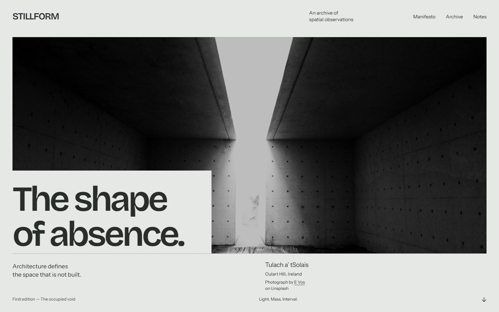
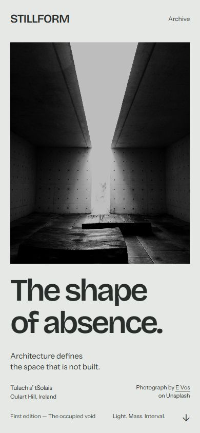
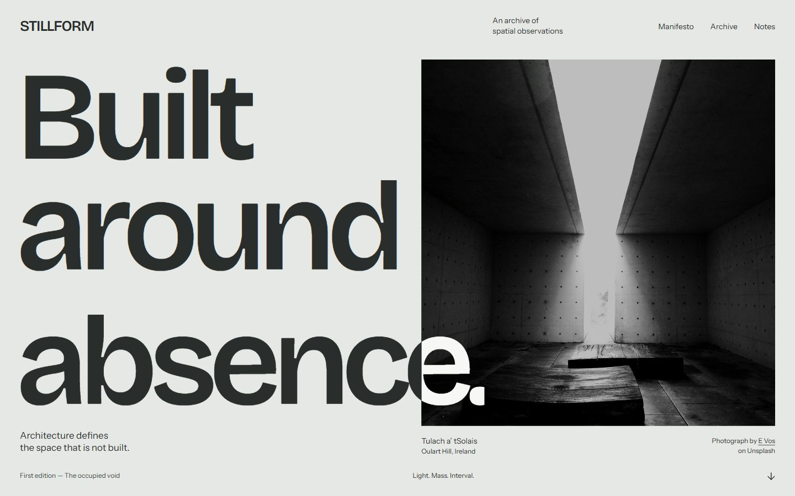
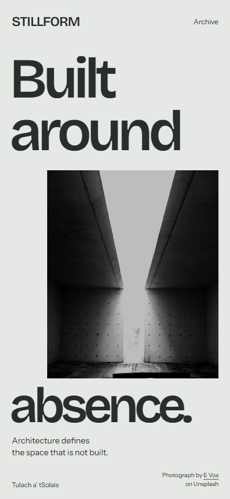

# STILLFORM — Hero visual study

**Phase 02B · 25 October 2026 · Static explorations for creative approval**

Two compositions within **Occupied Void**, using the same actual photograph, palette and locally loaded typefaces. These are browser-rendered HTML/CSS proofs, not generated mockups. **Recommendation: B**, subject to human approval. Neither locks the direction or implements the experience.

## A — Open field

[Open standalone HTML](proofs/variant-a.html)

The photograph dominates a 1368 × 624 field. Its narrow light shaft remains the focal point, while a mineral-colored lower-left cut makes room for **“The shape of absence.”** The page removes part of the photographic rectangle rather than placing a conventional text card on top. The image's mass and the layout's missing corner become related forms.

Bricolage Grotesque 600 gives the two-line, 102px headline more character than the previous neutral pairing. Small Instrument Sans metadata preserves an editorial register. The palette is mineral **#E5E8E4**, graphite **#292D2B**, and chalk **#F7F8F5**; the photograph retains its original monochrome treatment.

Mobile deliberately changes the relationship: a 350 × 432 portrait crop comes first, followed by a separate 61px headline. The light shaft remains intact. This gives the photograph authority and keeps reading straightforward, but loses some of the desktop's cutout identity. It is an intentionally calmer alternative, not a scaled-down desktop.

**Strength:** the most expansive photographic impression. **Weakness:** the panoramic crop sacrifices roof and floor context; the mobile image-then-title structure remains comparatively familiar. Its distinctiveness depends heavily on photographic quality.

## B — The cut

[Open standalone HTML](proofs/variant-b.html)

**“Built / around / absence.”** becomes the composition's primary mass. The 228px headline occupies the left field; a roughly 641 × 665 photograph occupies the right. The ending of “absence.” crosses the photographic edge and changes abruptly from graphite to chalk at that boundary. This is a hard color division, not a decorative gradient or blend-mode effect. The actual light shaft stays uncovered.

The headline's unusually close spacing and broad letterforms create pressure against the straight photographic edge. The image has enough vertical room to retain the floor and converging concrete planes. A small explanatory sentence and precise attribution balance the large gesture without introducing another display style.

Mobile makes the concept more literal: **“Built / around”** appears above a narrow, right-aligned photograph, and **“absence.”** closes the composition across its lower edge. The image occupies the interval inside the sentence. The frame is 290 × 420; opening words are 96px and the closing word 84px. The closing mineral field overlaps the base, while the light shaft remains visible. Extra footer metadata is omitted to preserve space for the main statement and attribution.

**Strength:** typography participates in the idea, and the mobile composition has its own memorable logic. **Weakness:** the headline competes more strongly with the architecture; the boundary intersection needs careful adaptation at other widths. The dense mobile closing area has little room for additional copy. This should remain a short editorial statement, not acquire a marketing CTA stack.

## Critical comparison and recommendation

| Criterion | A — Open field | B — The cut |
| --- | --- | --- |
| First impression | Architectural scale and photographic immersion | Forceful typographic mass and an image/text collision |
| Connection to Occupied Void | The missing corner frames the title | The photograph interrupts a sentence; text meets material at a precise boundary |
| Mobile authorship | Good crop and clean reading, more familiar structure | Distinct composition that preserves the underlying idea |
| Photographic context | Broad crop removes vertical context | Taller frame retains more of the spatial sequence |
| Engineering burden | Low for static composition | Low–medium: responsive title placement and boundary alignment |
| Main risk | Still too conservative for the portfolio ambition | Type becomes a poster gimmick if every later section repeats its scale |

**Advance B to the separate Hero art-direction/keyframe review.** Its stronger authorship is already visible without animation. Keep A as the photographic-scale counterpoint, not as another direction to combine indiscriminately with B. The later Manifesto should lower typographic pressure and let the opening become reading space; repeating the giant headline treatment would weaken the narrative.

The proposed Hero-to-Manifesto transition and Archive expansion are described in [Art direction refinement](ART_DIRECTION_REFINEMENT.md). Neither is implemented or demonstrated by these static captures. The [asset shortlist](HERO_ASSET_SHORTLIST.md) explains the image selection and its reuse basis.

## Evidence and limits

- Four actual browser screenshots saved at **1440 × 900** and **390 × 844**; encoded JPEG dimensions independently verified.
- Browser document dimensions matched each requested viewport, with no horizontal overflow in these four states. The photograph was fully loaded; local display/body font checks passed.
- Browser full-page capture was used because the ordinary viewport capture reflected the physical browser surface. The full document equaled the requested viewport in each case. [Capture audit](proofs/screenshots/capture-audit.json).
- Both HTML documents contain **zero scripts**. Navigation labels are static compositional placeholders; only source-credit links are functional. No GSAP, React or Astro components were created.
- These are two target-size proofs, not responsive production QA. Intermediate widths, text zoom, real-device behavior, Safari and motion performance remain untested.
- Existing application code, AGENTS.md and reverse-engineering documents were preserved. The reference board's four local image paths were converted to portable relative links.

**Approval requested:** choose a composition and identify any desired typography/crop adjustments. Production implementation and final assets remain outside this phase.
