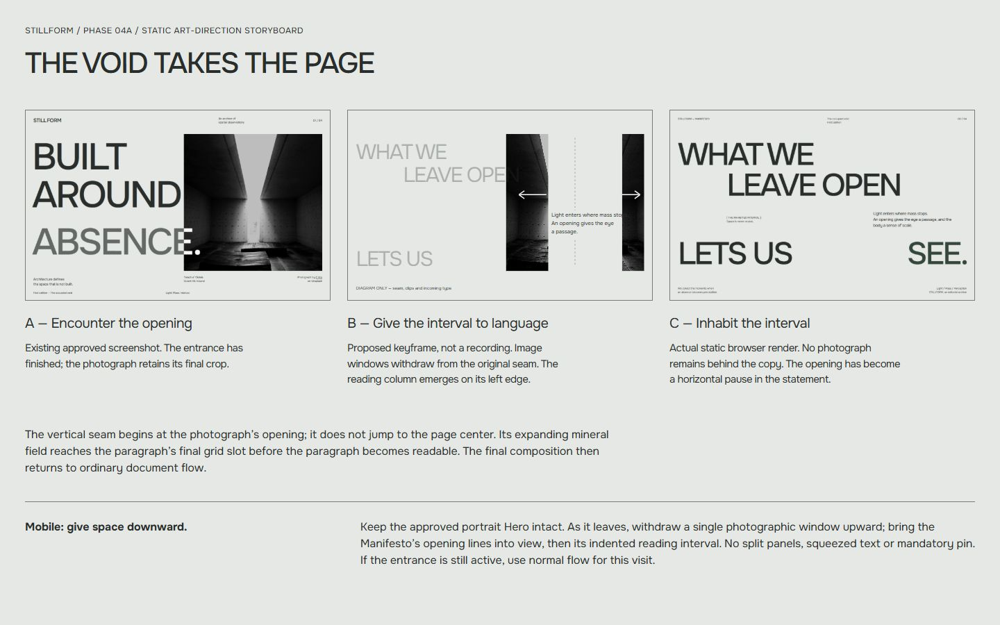

# STILLFORM — The Void Takes the Page

Phase 04A · Artistic storyboard only. No ScrollTrigger implementation or measured timing.

[Open the static board](proofs/manifesto/storyboard.html) · [Browser screenshot](proofs/manifesto/screenshots/storyboard-1440x900.png)

## Composition states

| State | Composition and intention |
| --- | --- |
| A — Final Hero | Preserve the approved Hero exactly: Onest 500, current ABSENCE ink and chalk intersection, E Vos photograph and final CSS crop. The existing cinematic entrance finishes under its own ownership. No animation is restarted or settled by scroll. |
| B1 — Opening becomes an interval | Read the opening from the actual final photo geometry. At the 1440 anchor its horizontal origin is approximately x=1076px, not page center. The Hero heading leaves as one editorial unit with the section. Two registered rectangular photographic windows withdraw from that origin; this is a separation of image planes, not a building physically splitting. |
| B2 — Interval receives language | Expand the mineral gap toward the paragraph's final slot, approximately x=961px at 1440. Keep that destination stationary. The paragraph becomes legible only once a complete reading width is clear. The new statement establishes the upper and lower edges of a horizontal pause. No paragraph is squeezed between moving slivers. |
| C — Final Manifesto | Direction A's exact static composition: upper WHAT WE / LEAVE OPEN, indented annotation and right reading passage, lower LETS US / SEE. No photo remains behind text. Release into ordinary reading flow. Nothing continues to pulse, blur, scrub or drift while reading. |

The board's intermediate SVG is a schematic of withdrawal and receiving space; arrows/dashed seam are explanatory annotations, not UI. It does not establish final masks, source-image coordinates or animation keyframes. Initial/final panels are actual screenshots. The actual source remains [E Vos's photograph](https://unsplash.com/photos/dark-concrete-hallway-with-bright-light-at-the-end-ela0A8rSxbw), reused from existing study assets; attribution/clearance history remains in [HERO_ASSET_SHORTLIST.md](HERO_ASSET_SHORTLIST.md). No new asset rights are asserted.

## Mobile, tablet and ultrawide

**Mobile:** receive space downward. The approved portrait Hero and ABSENCE backing stay intact. A single photographic window can withdraw upward as the next chapter enters normal flow. WHAT WE / LEAVE OPEN arrives before the indented paragraph; LETS US / SEE. closes below it. No full-screen lateral split, narrow live text corridor or mandatory pin. Reduced motion and constrained-height layouts simply show consecutive static sections.

**Tablet:** prefer the same normal-flow handoff unless both section geometry and readable height support the desktop passage. The static 768 study is intentionally recomposed, not a desktop scene scaled down.

**Ultrawide:** derive the seam from the height-limited, right-anchored Hero photograph, never `0.75 * viewportWidth`. A's paragraph stays in its final grid slot and capped measure. Expand the mineral clearing leftward until it encompasses that slot; do not drag the paragraph across the page to compensate. Bounds come from the measured receiving column. The far-right SEE. keeps the page edge active after the photograph disappears.

## Feasible technical shape, for later approval

Native Astro section: one semantic heading, separate reading paragraph, annotation and footer note. Keep heading text accessible as one sentence even though its visible spans surround an independent paragraph. No duplicate spoken text. CSS Grid handles the settled composition. No React, SplitText, Flip, canvas or extra scrolling library is necessary.

A later page-level TypeScript coordinator may own **one** cross-section timeline with ScrollTrigger. A short desktop passage around 0.7–1 viewport is an artistic starting range, not a locked duration. Prefer direct scroll mapping with `ease: none`; test a small scrub catch-up only if it improves continuity. If pinning is justified, pin a stable wrapper and animate its children, not the pinned element. One controller must own refresh, reversal and cleanup. [Official ScrollTrigger documentation](https://gsap.com/docs/v3/Plugins/ScrollTrigger/).

**Entrance isolation is non-negotiable:** the transition must not write to the entrance's targets while that entrance owns them. Gate transition admission on entrance completion/static settlement without changing the entrance. If the visitor scrolls past the scene before it becomes eligible, use normal document flow for that visit; never hold scrolling, force the Hero to finish, insert a late pin, or pull the user backward. The current implementation's status integration needs a separate implementation review; no new public hook is assumed to exist.

| Risk | Simplest acceptable solution |
| --- | --- |
| Duplicate photo crop jumps | Reuse the same source, final scale and measured crop registration. No inner zoom reset. Snapshot geometry only after entrance ownership ends. |
| Large composited surfaces | Two bounded rectangular windows; transform/clip only, no blur, no full-page image plane, no traced architectural silhouette. |
| Resize or text growth | Refresh from real geometry outside animation ticks. Preserve progress, choose normal-flow fallback if reading space no longer fits. Never shrink user text. |
| Stacking/backing regression | Transition decorations have their own local layer; do not remove or alter the approved closing-word backing or entrance proxy stack. |
| Fast scroll/history entry | Static readable flow is always available; no late replay or forced scroll restoration by the transition. |
| Reduced motion, JS/image failure | Consecutive fully readable sections; no clipping, pin or hidden text dependency. |

**Complexity:** static A layout low; desktop two-window handoff medium. Simplest motion prototype: one rectangular photographic curtain clearing the same receiving area. Compare it with two windows before accepting extra layers. No per-word stagger, parallax, hover effect or reading-progress color sweep is proposed.

## Approval boundary

Approve the receiving composition and copy first. A later motion prototype must prove crop continuity, early-scroll independence, reverse scrolling, resize, focus access and readable static fallback. This phase provides visual evidence and artistic intent only; it does not authorize production Manifesto work, entrance changes, Archive or Outro.
