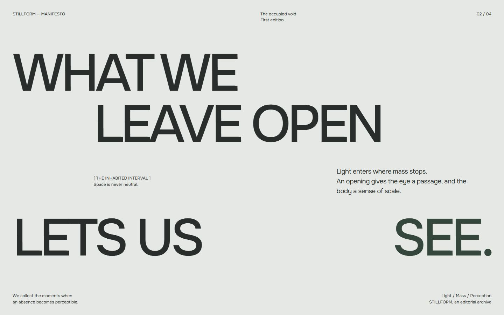
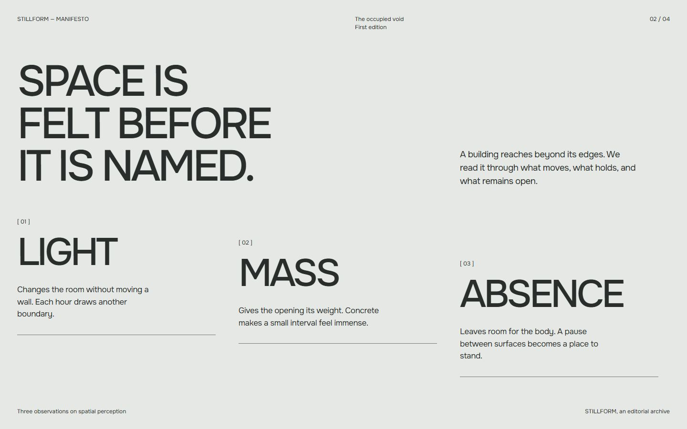

# STILLFORM — Manifesto visual study

Phase 04A · 26 October 2026 · Actual static browser renders, not motion captures.

## Compare the compositions

| Direction | Desktop 1440 × 900 | Mobile 390 × 844 | Runnable HTML |
| --- | --- | --- | --- |
| A — The Inhabited Interval | [PNG](proofs/manifesto/screenshots/a-1440x900.png) | [PNG](proofs/manifesto/screenshots/a-390x844.png) | [Direction A](proofs/manifesto/direction-a.html) |
| B — Three Ways of Seeing | [PNG](proofs/manifesto/screenshots/b-1440x900.png) | [PNG](proofs/manifesto/screenshots/b-390x844.png) | [Direction B](proofs/manifesto/direction-b.html) |

**A desktop:** the paragraph sits between two typographic masses. LEAVE OPEN is offset, while LETS US / SEE. stretches across the section. The right-hand reading slot relates to the Hero's opening without retaining a decorative photograph. The 12px annotation is intentionally subordinate; it is not a second heading.

**B desktop:** the three observations create a descending rhythm and more explicit argument. Reducing the introductory headline from the first draft kept all three observations visible at the desktop anchor. Its familiar three-column structure makes it less distinctive than A.

**Mobile:** A keeps the spatial pause and rightward reading indent; B deliberately removes the diagonal and becomes a compact series. All copy and footer fit the requested 390 × 844 capture at default text size. Neither uses hidden overflow. The mobile footer is 12px; B's observation indices alone are 11px. Future production should revisit indices if their hierarchy proves too slight.

## Recommended A across sizes

| CSS viewport | Proof | Observations |
| --- | --- | --- |
| 768 × 1024 | [Tablet PNG](proofs/manifesto/screenshots/a-768x1024.png) | 85.76px display; 24px gutter. Paragraph sits beside annotation; the large lower breathing area is visible and may be tightened in a later approved refinement. |
| 1920 × 1080 | [Large desktop PNG](proofs/manifesto/screenshots/a-1920x1080.png) | 182.4px display; 48px gutter; body caps at 24px. Complete composition captured. |
| 3440 × 1440 | [Complete overview](proofs/manifesto/screenshots/a-ultrawide-overview.png), [runnable overview](proofs/manifesto/ultrawide-overview.html) | Actual 3440 × 1440 iframe rendered at 40% review scale. 250px display cap, 86px gutter, 28ch body limit. Full composition remains distributed across the page. |

**Native ultrawide capture limitation:** the browser reports an actual 3440 × 1440 viewport and document, but its native screenshot returns **3440 × 1387** with clipped peripheral content. Both full-page and explicit-clip capture calls failed. The [available native capture](proofs/manifesto/screenshots/a-ultrawide-visible.png) is partial evidence, **not** a complete 3440 × 1440 screenshot. The overview is an actual browser capture of a full-size iframe, not an image fabricated or upscaled to meet the target. Open Direction A directly at 3440 × 1440 for native inspection. An [earlier cropped capture](proofs/manifesto/screenshots/a-ultrawide-earlier-cropped.png) predates the ultrawide spacing correction and is not the final target.

The first ultrawide pass grew to 1493px tall. Reducing the top lead-in and the interval's minimum height brought the final document to 1440px, without hiding content or reducing user text. This is a visual study adjustment, not a fixed-height production requirement. The long horizontal gap remains intentional; body text does not expand to fill it.

## Verification and reproducibility

- [Render checks](proofs/manifesto/render-checks.json): requested viewport, document dimensions, computed family/display size and `document.fonts.check('500 100px Onest')` after font readiness. All final tested documents have no horizontal overflow at default text size.
- [Shared CSS](proofs/manifesto/shared.css) loads only the existing local [Onest variable WOFF2](proofs/onest/assets/Onest-Latin-Variable.woff2), weights 100–900. Computed family is Onest; loaded-font check succeeded. This is DOM/font readiness evidence plus visual review, not a DevTools per-glyph font trace. The existing [font license](proofs/onest/assets/OFL.txt) remains with the asset.
- All seven requested viewport configurations were rendered. Six requested native-size PNGs were captured successfully; ultrawide has the explicitly limited native capture and complete scaled overview.
- No performance trace, physical-device testing, screen-reader audit, enlarged-text test or intermediate-width production QA is claimed. These are disposable static explorations. Natural growth is authored; comprehensive reflow acceptance belongs to implementation.
- Open either HTML directly in a browser, or run the existing `docs/creative/proofs/serve.ps1` and visit `/manifesto/direction-a.html` or `/manifesto/direction-b.html` on port 4179. No build or dependency installation is needed.

The [static storyboard](proofs/manifesto/screenshots/storyboard-1440x900.png) combines existing Hero evidence, an explicitly schematic intermediate frame and the new settled A render. [Motion intention and constraints](MANIFESTO_TRANSITION_STORYBOARD.md).

**Recommendation: A.** Human approval is still required. Production Hero, entrance, application source and AGENTS.md were not modified.
