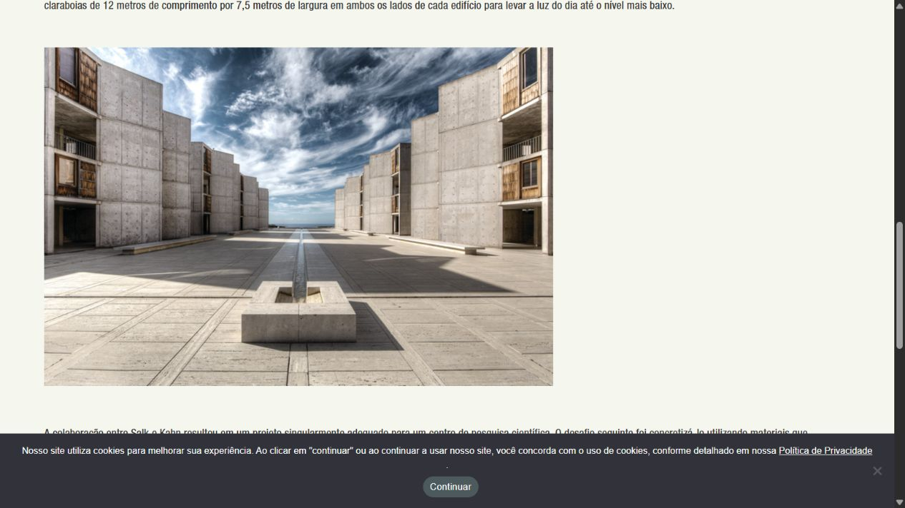
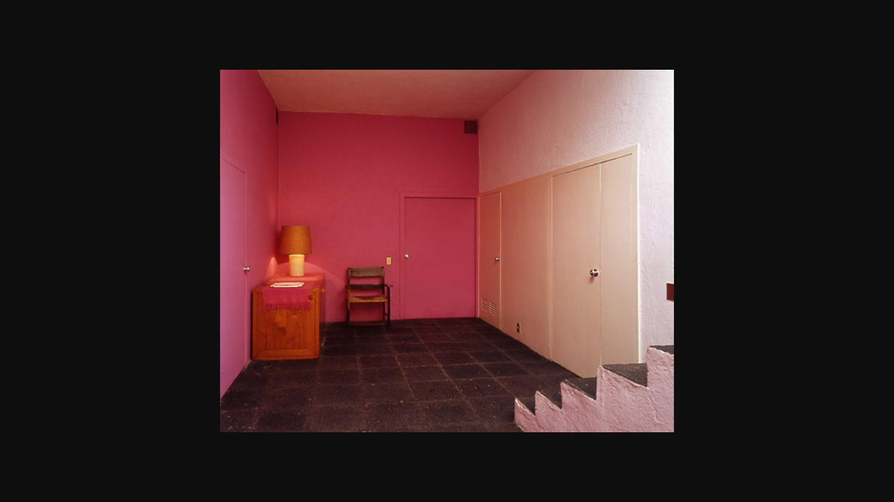
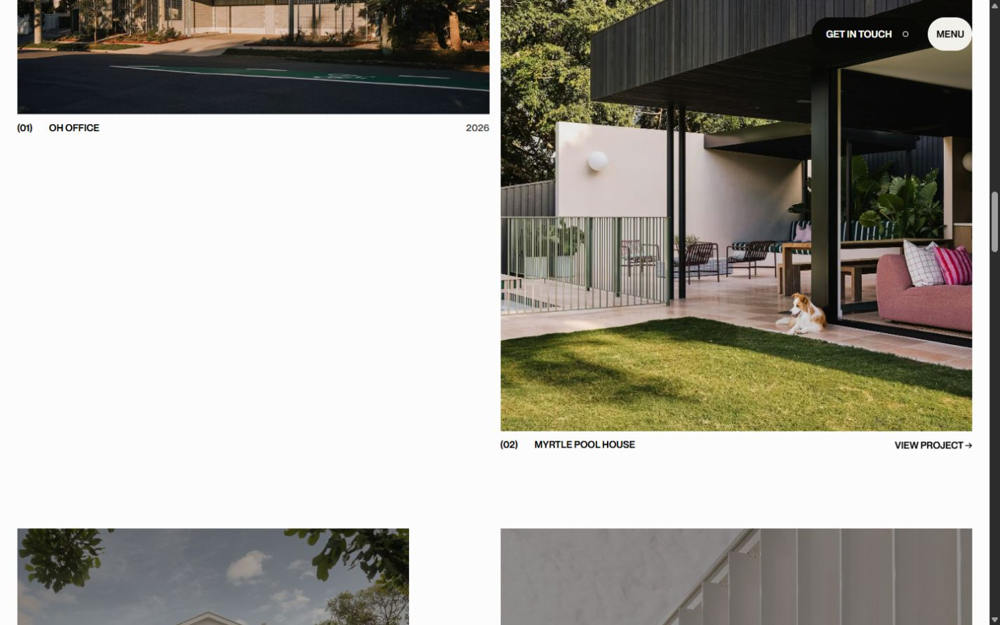
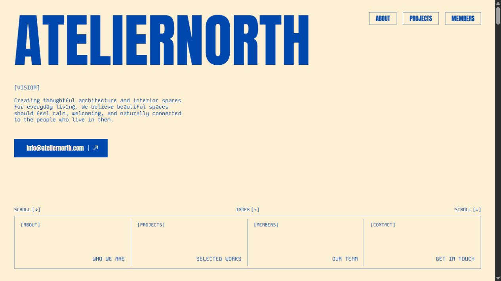

# STILLFORM — Visual reference board

**Phase 02 · Verified/reviewed 25 October 2026 · Research references, not production assets**

This is a curated evidence board for the two [art-direction proposals](ART_DIRECTION_PROPOSAL.md). It is not a composite design to reproduce. Each item identifies what was accessed, the quality worth studying and the specific decision it supports.

**Evidence labels:** **Observed** = visible in a live page or saved Phase 01 capture; **Source-confirmed** = established in the reviewed public source or official text; **Proposal** = our own creative interpretation. All proposed fonts, palette values, layouts and copy remain subject to human approval.

The Phase 01 [teardown](../research/REFERENCE_TEARDOWN.md) and [capture manifest](../research/evidence/screenshots.json) remain the detailed record of viewport sizes and capture context. New architectural screenshots have separate [capture notes](references/REFERENCE_CAPTURE_NOTES.md). Photographer credit/reuse permission was not established for the institutional photographs below; no production reuse is assumed.

## Board at a glance

| Reference | Specific quality | Proposed decision | Applies to |
| --- | --- | --- | --- |
| Salk Institute courtyard | Material masses make an open interval palpable | Choose a Hero around an opening, then make an empty layout interval meaningful | A: Hero, Manifesto, Outro |
| Casa Luis Barragán vestibule | Color is experienced through adjacent surfaces and reflected light | Pair a context view with a precise chromatic/material trace | B: all four chapters |
| OH works composition | Unequal image scale within a consistent underlying structure | Give four records distinct editorial weight while keeping captions attached | Both: Archive |
| OH entrance/settled states | Motion resolves into a composed, readable page | Let motion clarify a strong static hierarchy | A: Hero; both: general restraint |
| Atelier North type and color | A small number of formal choices can define an unmistakable identity | Sustain one visual rule rather than collecting effects | Both: system discipline |
| Atelier sticky members + C mask sequence | A stable spatial reference can connect successive information | A brief held relationship is possible; complex masks remain optional | A: Manifesto; both: continuity principle |
| Official type sources | Real, accessible font families with defined roles | Two distinct typographic voices with no dependency on unavailable custom fonts | A and B |

## 1. Salk Institute — mass framing an interval

**Source:** [Salk Institute, About Salk Architecture](https://www.salk.edu/about/about-salk-architecture/). **Access:** official page text and courtyard photograph inspected in the browser on 25 October. Screenshot captured from the page; its translated text and cookie notice are retained as context.

**Observed:** the two flanking masses and the thin central watercourse direct the eye toward the open horizon. Foreground shadow and paving joints reinforce depth without requiring a moving camera. The sky and empty court are substantial visual subjects.

**Source-confirmed:** the institution describes Kahn's paired structures flanking a travertine courtyard and his attention to natural light.

**Proposal — A:** study how solid material gives empty space a shape. Let one photographic opening answer the page's empty interval. A new Hero may be asymmetric; the Salk photograph's central axis is not a layout template.

**Do not inherit:** this exact photograph, courtyard silhouette, dramatic sky treatment or centered composition. No claim is made that this image is licensed for STILLFORM.

## 2. Casa Luis Barragán — color as a spatial relationship

**Source:** [official Vestibule page](https://www.casaluisbarragan.org/eng/en_vestibulo.html); [the photograph observed in that page's DOM](https://www.casaluisbarragan.org/img/lacasa/vestibulo2.jpg). **Access:** official text inspected; the page's carousel appeared blank despite loaded images. The observed photograph URL was opened directly and visually inspected in the browser.

**Observed:** saturated pink walls meet a pale plane, a dark stone floor and a foreground stair edge. The color remains attached to surfaces with texture and perspective; it does not read as an overlay.

**Source-confirmed:** the official text discusses reflected light, pink walls and the relationship between color and spatial perception.

**Proposal — B:** make the whole/detail relationship the editorial unit. A detail of a surface junction or reflected color should explain why the contextual view is memorable. Lavender and plum in the proposed UI are our choices, not extracted historical colors.

**Do not inherit:** the exact room, furnishings or palette as a compulsory asset brief. This is evidence of a visual relationship, not an authorized image supply. The photograph's author was not identified in the inspected view.

## 3. OH Architecture — unequal emphasis, stable order

**Source:** [OH Architecture](https://www.oharchitecture.com.au/). **Evidence:** Phase 01 desktop/mobile browser inspection and runtime measurements, retained in the research documents. The works capture was reopened and visually reviewed in this phase.

**Observed:** the portrait image carries substantial weight while the neighboring image and caption create a different reading pace. Captions remain attached to figures rather than becoming separate cards.

**Runtime-confirmed in Phase 01:** a 12-column grid, differing image proportions and responsive spacing. This is evidence about that reference, not a mandatory grid specification for STILLFORM.

**Proposal — both directions:** assign editorial roles to figures. A uses hierarchy around a recurring alignment. B uses a whole/detail relationship. Neither uses a random masonry collage.

**Boundary:** do not reproduce OH's project layout sequence, photography, navigation treatment or brand typography. Its proprietary animation implementation remains unknown.

**Responsive study:** [OH mobile works](../research/evidence/oh-mobile-02-works.jpg) and [OH mobile Hero](../research/evidence/oh-mobile-01-hero.jpg). Study what retains hierarchy when the desktop width disappears; STILLFORM's specific mobile layouts are new proposals.

## 4. OH process sequence — the settled composition matters

**Sources:** [entry state](../research/evidence/oh-wide-05-process.jpg) → [settled state](../research/evidence/oh-wide-06-process-settled.jpg), captured during live interaction in Phase 01. See the [teardown](../research/REFERENCE_TEARDOWN.md) for the observation context.

**Observed:** the text/image relationship resolves over successive states. These frames demonstrate a change, not a measured duration or an easing curve.

**Proposal — A:** one coordinated arrival may establish the Hero, but the settled text, crop and spacing must carry its meaning. This supports the “static composition first” review criterion.

**Boundary:** no exact timing, hidden timeline structure or source ownership is inferred from screenshots.

## 5. Atelier North — identity through a few sustained choices

**Sources:** [live reference](https://atelier-north.crnacura.workers.dev/), [Codrops article](https://tympanus.net/codrops/2026/10/09/architecture-studio-astro-gsap/), [public repository](https://github.com/codrops/atelier-north). Source review in Phase 01 pinned commit `6703fc3f15ec92979964070814a99855d0baa38f`.

**Observed/source-confirmed:** large condensed type, smaller mono text and a highly restricted color pairing form a strong visual identity. Astro layout/page/card files and direct GSAP scripting underpin the experience.

**Proposal — both directions:** choose one coherent formal grammar. For A, that is a massive figure and a meaningful interval. For B, it is a contextual view and a trace. Consistency is the transferable principle; Anton, Kode Mono, cream/blue and pixelation are not.

**Boundary:** the proposal deliberately excludes the pixel-resolution effect and grid-cell color boundary. They are identifiable parts of Atelier's own language, with unnecessary rendering work for STILLFORM's current concepts.

**Specific source paths:** [Layout.astro](https://github.com/codrops/atelier-north/blob/6703fc3f15ec92979964070814a99855d0baa38f/src/layouts/Layout.astro), [ProjectCard.astro](https://github.com/codrops/atelier-north/blob/6703fc3f15ec92979964070814a99855d0baa38f/src/components/ProjectCard.astro), [global.js](https://github.com/codrops/atelier-north/blob/6703fc3f15ec92979964070814a99855d0baa38f/src/scripts/global.js), [top.scss](https://github.com/codrops/atelier-north/blob/6703fc3f15ec92979964070814a99855d0baa38f/src/styles/top.scss).

## 6. Stable reference, changing attention — a technical motion board

| Evidence | Verified mechanism / observation | Creative use and limit |
| --- | --- | --- |
| [Atelier desktop members](../research/evidence/atelier-desktop-07-members.jpg) and [mobile members](../research/evidence/atelier-mobile-03-members.jpg) | Source uses CSS sticky for the title relationship while cards move in document flow. | A's Manifesto may keep an image present while the reader interprets it. Do not inherit the long demo section length. |
| [C entry](../research/evidence/mask-desktop-01-entry.jpg) → [settled](../research/evidence/mask-desktop-02-settled.jpg) → [progress](../research/evidence/mask-desktop-03-progress.jpg) → [next scene](../research/evidence/mask-desktop-04-transition.jpg) | Live horizontal variant inspected; SVG rectangles expose stacked imagery while one scroll sequence coordinates text and image. | Study continuity and a shared spatial reference. Neither proposal needs a many-strip or random-cell transition. A's single planar reveal is an original simplification, not C's copied effect. |

C sources: [Codrops tutorial](https://tympanus.net/codrops/2026/03/11/svg-mask-transitions-on-scroll-with-gsap-and-scrolltrigger/), [live horizontal demo](https://tympanus.net/Tutorials/SVGMaskScrollTransition/), [source script at the reviewed commit](https://github.com/Hiro-kiii/Scroll-Transition/blob/6bb67c598f767a014ac595c904d85b86119670ee/js/script.js).

The sequential captures are not uniformly timed and cannot establish frame rate. Other variants were source-studied in Phase 01, not all live-tested. Neither sticky nor scrub is mandatory simply because it exists in a reference.

## Type and sourcing references

The following are **verified primary sources for availability and family purpose**, not finished STILLFORM specimens. Font fitting against the final copy/crops is deferred to the approved Hero phase. No production fonts were installed or assets generated here.

| Proposed role | Verified source | What to study / decision |
| --- | --- | --- |
| A display and UI: Archivo | [Omnibus-Type official Archivo page](https://www.omnibus-type.com/fonts/archivo/) | Normal-width letterforms and the contrast between medium display weight and quiet UI text. Use the family for structural clarity rather than imitating Atelier's condensed title. |
| A reading: Source Serif 4 | [Adobe's official Source Serif repository](https://github.com/adobe-fonts/source-serif) | Its text/display range supports a dedicated reading voice. Keep the serif in prose; do not spread an additional type personality across all labels. |
| B display and prose: Newsreader | [Production Type's official Newsreader repository](https://github.com/productiontype/Newsreader) | Designed for continuous screen reading; proposed here as a sustained essay voice, including the large sentence. Check large-size spacing in the next phase rather than assuming it is finished. |
| B functional text: Public Sans | [USWDS official repository](https://github.com/uswds/public-sans) | A neutral UI companion. The former specimen site redirects; the repository remains the verified font source. Its README reports that development is inactive and its variable fonts are experimental: use the existing static 400/500 styles if this direction is selected. |
| Future photograph candidates | [Unsplash's published license page](https://unsplash.com/license) | One possible sourcing route, not proof that any selected photo is cleared. Verify the individual asset and applicable license; distinguish free photos from Unsplash+ or other terms. A coherent photographer series or directly licensed photographs may better satisfy either direction. |

Archivo's official page and the three font repositories identify open-font licensing. Preserve the relevant license notices when fonts are eventually selected. No photograph's reuse status follows from the availability of its website or screenshot.

### Palette and typography decisions are proposals

The mineral/graphite/moss palette in A and lavender/plum palette in B are original choices. They are not claimed to be sampled from a museum, a building's original paint specification or a reference site's CSS.

Simple sRGB calculations for the proposed solid-color reading pairs give approximately:

| Pair | Calculated contrast |
| --- | --- |
| A graphite on mineral | 11.30:1 |
| A graphite on chalk | 13.09:1 |
| A chalk on moss | 9.40:1 |
| B plum on lavender | 9.35:1 |
| B plum on chalk, or chalk on plum | 12.19:1 |

These calculations support the proposed pairings; they are not a rendered accessibility audit. Secondary accent colors are not assigned to small required text. Typography sizing and pairings remain unrendered proposals.

## Access limits and exclusions

- The [Kimbell Kahn Building page](https://kimbellart.org/art-architecture/architecture/kahn-building) appeared in search results, but direct web access returned 403 and the browser displayed a security challenge. It is **not** included as a visually inspected reference or used to substantiate a photographic claim.
- The Barragán carousel did not visibly render its photographs in the page view. The saved capture is explicitly of the observed image URL opened in the browser, not a claimed working carousel.
- No paid archive, unavailable custom 3D collection, fabricated photographer portfolio or generated architectural image is part of this board.
- Phase 01 screenshots are reused by link; the original research and evidence were not overwritten.
- Nothing here approves a final direction, grants image rights, supplies production assets or begins implementation.

## How the board should inform approval

Choose A if the strongest attraction is **mass, interval and a continuous structural argument**. Choose B if it is **proximity, material color and the relationship between a view and its memory**. The board supports those differences without prescribing a reference site's composition.

The recommended next step, after human creative approval, is a separate Hero study with actual candidate crops, font fitting and keyframes. That work has not started.

