# STILLFORM — Reference teardown

Research started: **24 October 2026**. Documentation completed: **25 October 2026** (America/Sao_Paulo). Scope: evidence and practical interpretation only. No application implementation or final artistic direction is proposed.

## Read this first

The strongest shared lesson is **controlled hierarchy**: image scale, typographic scale, alignment and intervals establish the experience before animation contributes anything. OH turns architectural photography into the main spatial event. Atelier North makes typography and graphic rhythm the main event. These are distinct approaches, not ingredients that should automatically be combined.

Evidence labels used throughout:

- **Observed** — inspected in a live browser through scrolling, navigation, screenshots or rendered DOM/computed styles.
- **Source-confirmed** — present in the pinned public source snapshot.
- **Inference** — a plausible explanation or artistic interpretation, not a verified implementation fact.
- **Proposal** — a possible STILLFORM adaptation for later review.

Read [technical patterns](TECHNICAL_PATTERNS.md) for mechanisms and [implementation opportunities](IMPLEMENTATION_OPPORTUNITIES.md) for the seven-part evaluations and ranked shortlist.

## Sources, access and reproducibility

| Reference | Source | What was actually accessed |
| --- | --- | --- |
| A | [OH Architecture](https://www.oharchitecture.com.au/) | Live homepage: desktop and mobile-width scrolling, navigation overlay opening and closing, computed styles, script element URLs, image dimensions and console sample |
| B | [Atelier North live](https://atelier-north.crnacura.workers.dev/) | Live desktop/mobile-width homepage, image and title reveal states, pixel section boundary, sticky team composition, mobile menu and Projects anchor |
| B code | [Repository](https://github.com/codrops/atelier-north/tree/6703fc3f15ec92979964070814a99855d0baa38f) | 14 text files covering application components, layout, page, animation, styles, configuration and README; pinned commit `6703fc3f15ec92979964070814a99855d0baa38f` |
| B article | [Codrops, 9 October 2026](https://tympanus.net/codrops/2026/10/09/architecture-studio-astro-gsap/) | Article, author framing and implementation explanation; code snapshot is the primary implementation evidence |
| C | [Codrops, 11 March 2026](https://tympanus.net/codrops/2026/03/11/svg-mask-transitions-on-scroll-with-gsap-and-scrolltrigger/) | Article plus linked horizontal-blinds live demo |
| C code | [Scroll-Transition repository](https://github.com/Hiro-kiii/Scroll-Transition/tree/6bb67c598f767a014ac595c904d85b86119670ee) | Four authored JS variants, shared CSS and first HTML; pinned commit `6bb67c598f767a014ac595c904d85b86119670ee` |

The source was placed **outside the STILLFORM application**, at:

`C:/Users/Rafael/.codex/visualizations/2026/10/24/01a16fb4-9e2b-7842-a505-f62f179ecdce/references/`

Subdirectories: `atelier-north/` and `svg-mask/`. `SOURCE_MANIFEST.json` records remote blob hashes and selected files. All 20 downloaded text files were checked against their Git blob hashes after restoring original line endings/trailing newlines. This is a selected text snapshot, not a complete runnable clone. No reference dependencies were installed, no reference code was executed locally, and no application server was started.

Access limitations and recoveries:

- Chrome was unavailable through the browser tool; inspection used the available in-app browser.
- The web text fetcher could not open the Atelier live URL, but the interactive browser successfully loaded it.
- A local git clone failed when writing its config, and a direct archive request failed DNS resolution. The connected GitHub tool successfully supplied pinned source files.
- Screenshots and sequential states were supported. Video recording and a timestamped performance trace were not available in the exposed browser API.
- Desktop observations: OH at **1440 × 900**, plus an initial **905 × 712** sample; Atelier and C at **1280 × 720**. Mobile layout observations: A and B at **390 × 844**. These are viewport tests, not physical-device or touch-performance tests.
- Images can represent intermediate motion. Frames are **ordered inspection states**, not uniformly spaced video frames. Screenshots and subsequent DOM reads are not atomic, especially while smooth scroll is settling.
- No Lighthouse, network waterfall, CPU/GPU trace, measured FPS, LCP, CLS, INP, screen-reader audit, Safari test or real-device test was performed. Empty console samples do not establish an error-free site.
- The deployed Atelier build was not proven byte-identical to the repository. Visual behavior, markup classes and canvas structure align with the inspected source.

## A — OH Architecture

### Composition and grid

**Observed:** full-viewport architectural photography opens the page. A wordmark anchors the top left; navigation and the contact control sit on the right. A thin metadata row crosses the photograph near its middle. A compact positioning statement occupies the lower left. There is no decorative card around the hero.

At 1440 px, computed styles show a **12-column grid with 16 px column gaps** in the works list, process and footer grids. The works list had approximately **112 px row gaps** in that sample. Broad column spans and deliberate unoccupied areas produce asymmetry without losing alignment.

The studio section places an oversized two-line title over a much narrower image/text column. The work index pairs a landscape image with a tall image, then varies the widths and vertical placement further down. The process section puts a compact picture/list at the left and a much larger reading column nearer the middle.

**Interpretation:** empty space acts as a change of pace and establishes importance. The page does not require equal image sizes to feel ordered; repeated alignments do that work.

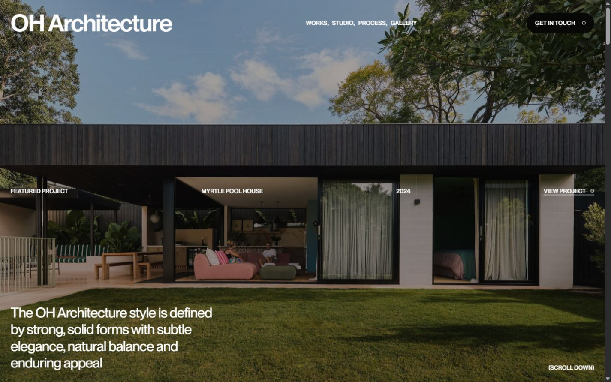

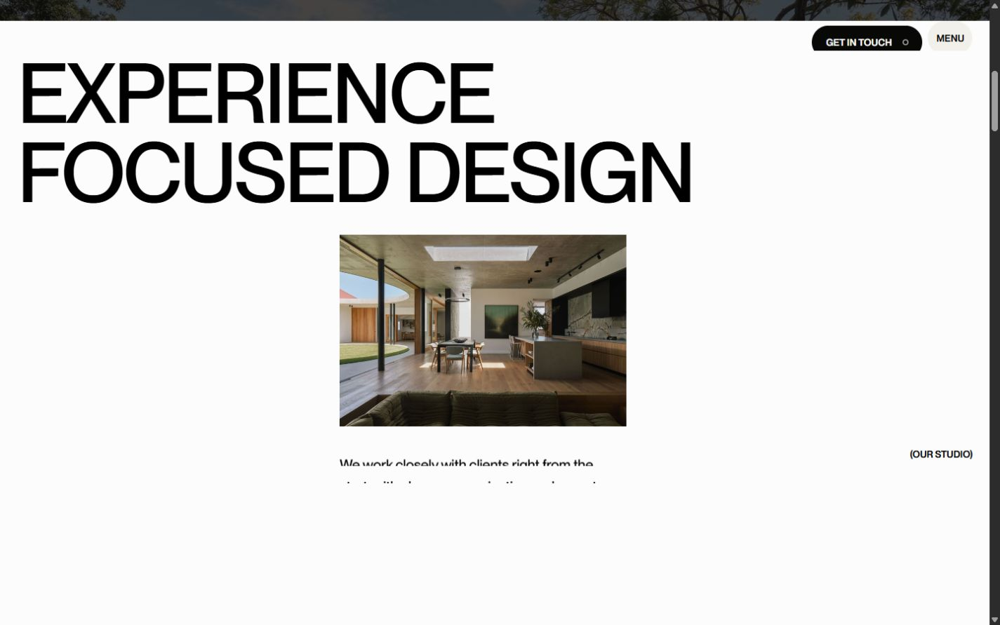

### Typography and hierarchy

**Observed:** computed font family is `"Ppneuemontreal Variable", Arial, sans-serif`. At the wide sample, the hero statement was approximately **32.7 px** and the principal section headings approximately **120 px**. At 905 px, sampled values were approximately 28.6 px and 81.9 px. This confirms responsive scaling; it does not establish the exact original sizing formula.

The same sans-serif family handles expressive large type, readable prose and small navigation. Tight large-type spacing, small uppercase metadata, thin rules and pill controls create distinct roles. The relative size difference matters more than adding font families.

**Interpretation:** the architectural photography remains expressive because the typography is direct and consistent. Translating this principle does not require adopting this font, capitalization system or wordmark treatment.

### Images, cropping and density

**Observed:** project image styles alternate **16 / 11** and approximately **0.736 / 1** aspect ratios. They use `object-fit: cover` and sampled `object-position: 50% 50%`. Several resting/reveal states had scale transforms around 1.05; hero image layers sampled at 1.15. These are point-in-time values, not measured animation endpoints.

At mobile width, the project list retains 12 computed tracks but uses narrow, offset single-image placements. Sampled image widths were about 286.5 px and 256.3 px. The tall hero crops much more of the original facade; it is not simply the desktop image scaled down.

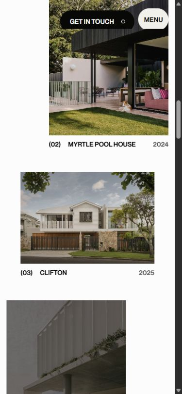

### Motion, interaction and continuity

**Observed sequence:**

1. Scrolling moves the hero composition into the white studio section. The imagery remains visually larger than its visible window, and the page moves from photographic density into open editorial space.
2. Studio/process text appears through clipped horizontal bands; a later state shows the full lines. A line-based reveal is visible, but its exact easing, duration, trigger range and replay policy were not measured.
3. An alternate compact contact/menu control remains available in scrolled states.
4. Opening Menu first exposes a dark panel and then the large navigation list; the underlying content is temporarily visible during the transition. The settled menu is an almost full dark field with large links and substantial empty space.
5. Menu closing was exercised. A full cross-route navigation transition was not audited.

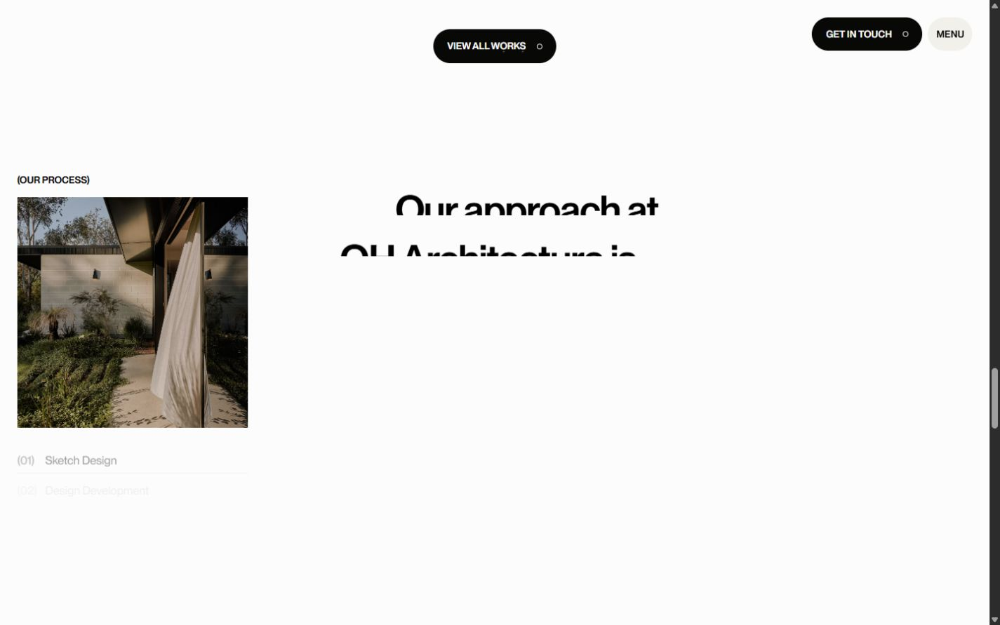

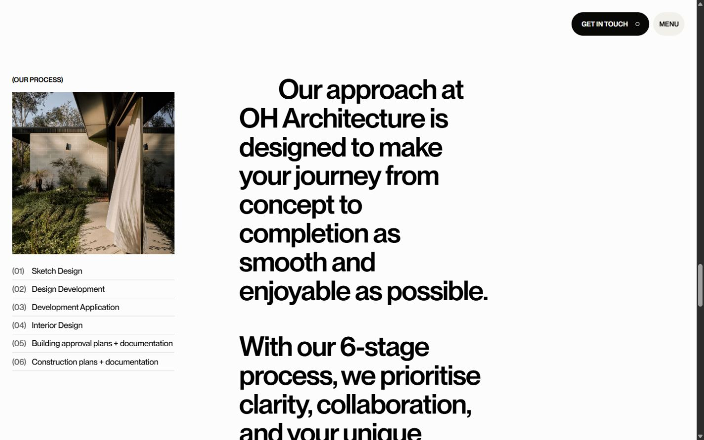

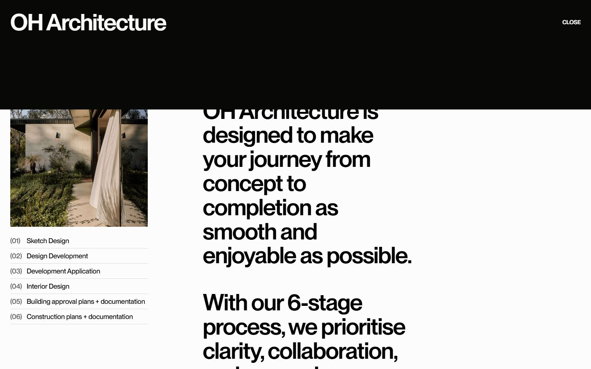

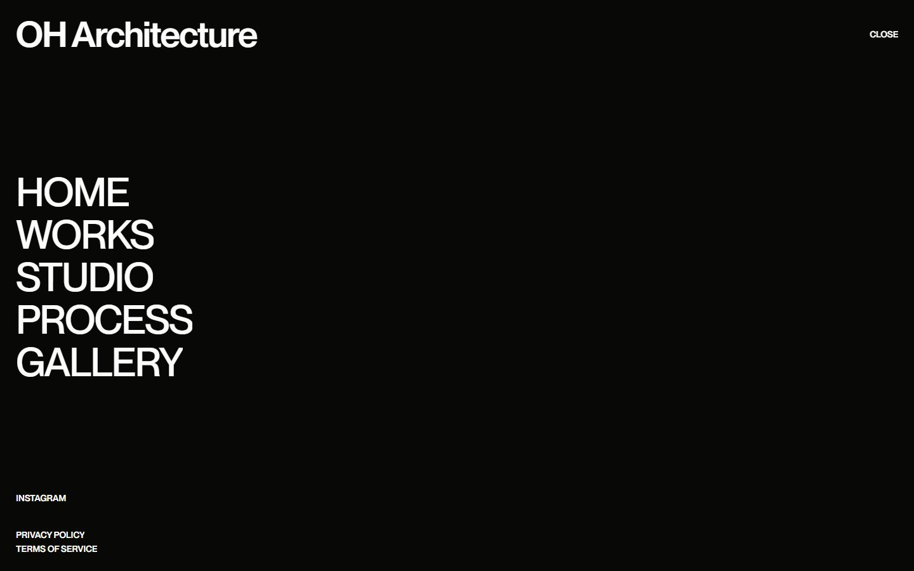

The DOM contains Webflow assets and script references for GSAP 3.12.7, ScrollTrigger, SplitText, CustomEase, Lenis 1.0.23, Barba, Draggable and Inertia. **Their presence does not prove which function implements a particular effect or that every script loaded successfully.** The proprietary application source was not copied or reverse-assembled. See the runtime boundary in the technical report.

**Mobile observations:** the top navigation becomes Menu; the hero metadata simplifies; the heading wraps into a narrow readable block; work imagery retains editorial offsets. The premium quality survives through composition rather than a completely different visual language.

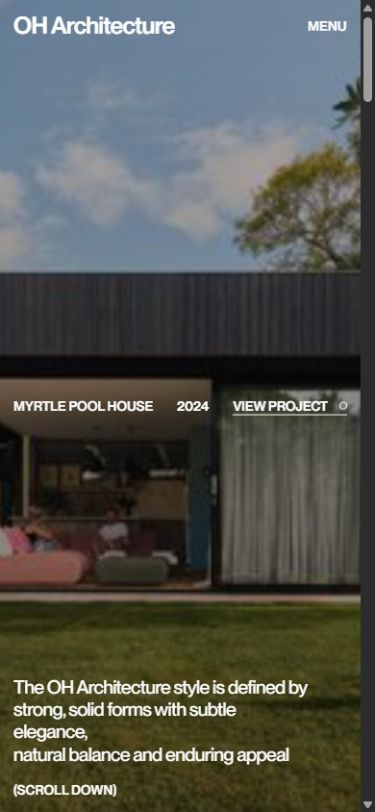

## B — Atelier North

### Composition, typography and identity

**Observed:** an enormous condensed wordmark leads a cream-and-blue opening without a hero photograph. A compact statement sits below it, while a four-cell index occupies the lower edge of the viewport. The wide area between them is intentional visual rest.

**Source-confirmed:** Anton provides display typography and Kode Mono provides body/metadata. Color variables are `#FEF0D5`, `#0048AE` and `#222222`. This is the reference's palette, not a STILLFORM palette proposal. The article connects the mono type to the pixel effects; the code and live site substantiate that relationship.

The homepage uses a 100svh opening, fluid clamp-based margins, 12-track editorial layouts and section-specific spans. Desktop about spacing reaches 192 px above/below; mobile spacing reduces to 80/120 px. Projects deliberately alternate portrait and landscape assets instead of forcing every image into one crop.

### Scroll choreography

**Observed and source-confirmed:**

- Source-confirmed opening behavior: letters expand vertically in randomized order. The source manually creates character spans; it does **not** use SplitText. The saved hero screenshot shows the settled state, not a timed recording of this entrance.
- The about title has an outlined version and an overlapping filled version. Scrolling progressively reveals the filled layer through a clip path.
- Project headings roll vertically within clipped wrappers. Project images begin as coarse pixel blocks, then become sharp while their canvas scales down.
- A band of square cells transforms the cream background into the dark team section, with sparse yellow accents.
- Team cards move through ordinary document scrolling over a sticky large title. The effect is not a ScrollTrigger pin.
- The header hides on downward scrolling and reappears on upward movement. Its source explicitly suppresses this response during anchor auto-scrolling.
- The mobile Menu panel rotates/fades in while its internal text rises into place. Clicking Projects closes the menu and moves to that section.

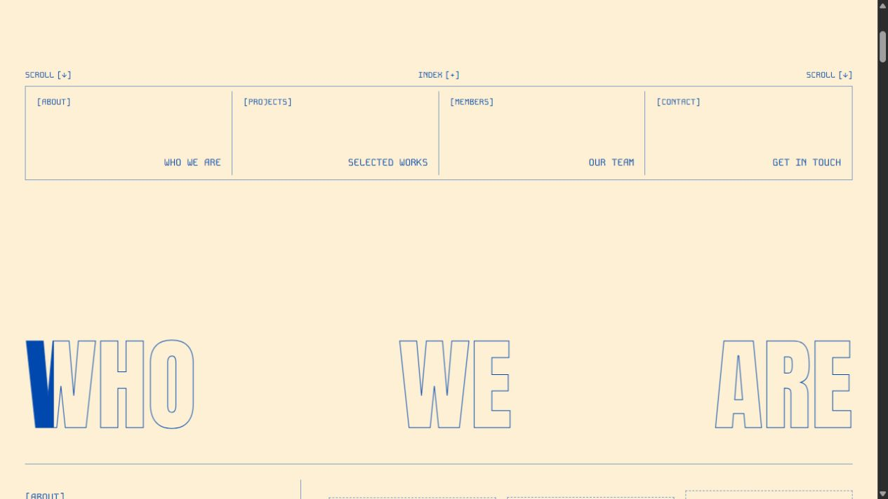

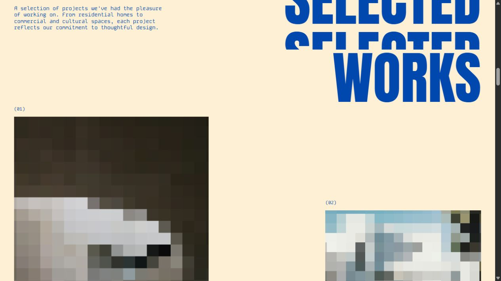

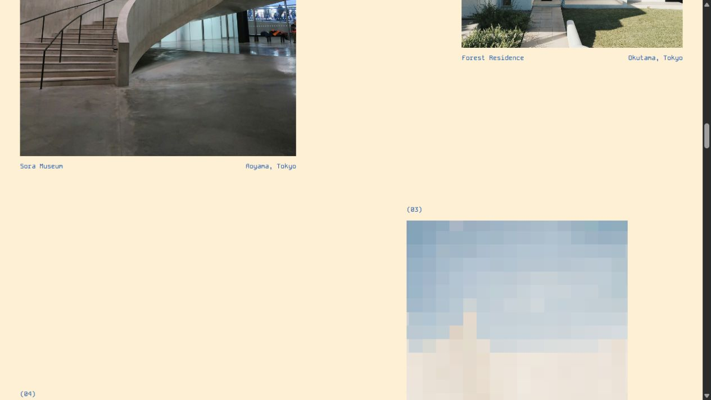

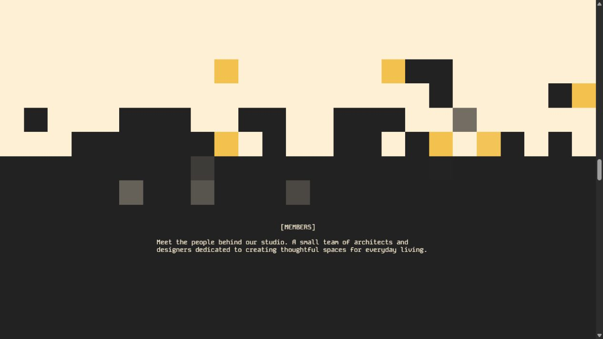

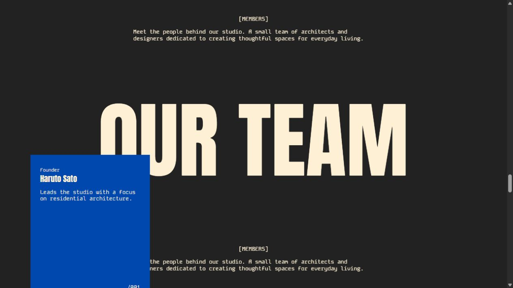

**Timing distinction:** the image reveal is a triggered 1.5-second animation. The about title uses `scrub: 1.5`; the pixel boundary uses `scrub: true`. A scrubbed tween's declared duration is a proportion of scroll progress, not a promise that the viewer sees a fixed-duration transition. The full source timing table is in the technical report.

### Responsive adaptation

The principal breakpoint is **1024 px**, defined by the `lg` Sass mixin:

| Element | Wide layout | Mobile-width layout |
| --- | --- | --- |
| Wordmark | Single line | Explicit line break |
| Header | Three exposed links | Menu button and overlay |
| Bottom index | Four columns | Two by two |
| About lead | 12-column arrangement with floating boxes | Stacked text; floating boxes hidden |
| Projects introduction | Text beside right-aligned title | Title before introduction |
| Project cards | Five cards over three grid rows, with offsets | Five rows with alternating column spans |
| Team | Dispersed cards over sticky title | Alternating narrow cards; sticky section retained |
| Footer | Viewport-height desktop composition | Content-driven height and rearranged metadata |

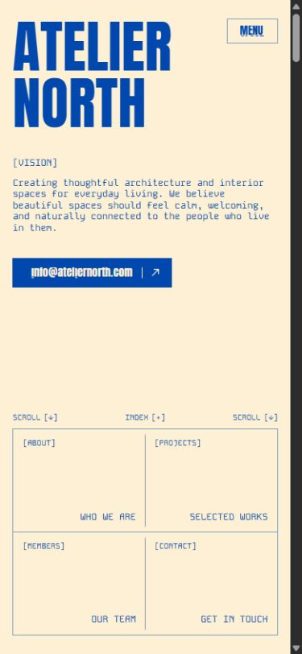

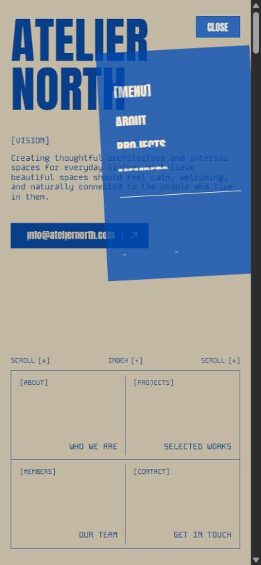

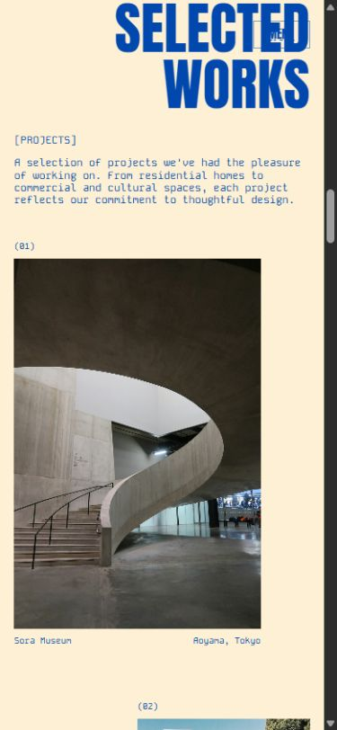

**Interpretation:** the identity is coherent because its animation vocabulary grows from its graphic vocabulary. The specific pixel motif is a strong identity choice, not a universally premium effect. The six-viewport team section is also a large reading-time commitment; that would need justification for a single-person portfolio.

## C — SVG masks, reserved for later sections

The [horizontal-blinds demo](https://tympanus.net/Tutorials/SVGMaskScrollTransition/) was scrolled live through the first and second scenes. The screenshots show partial mask opening, the settled first scene and a later second scene.

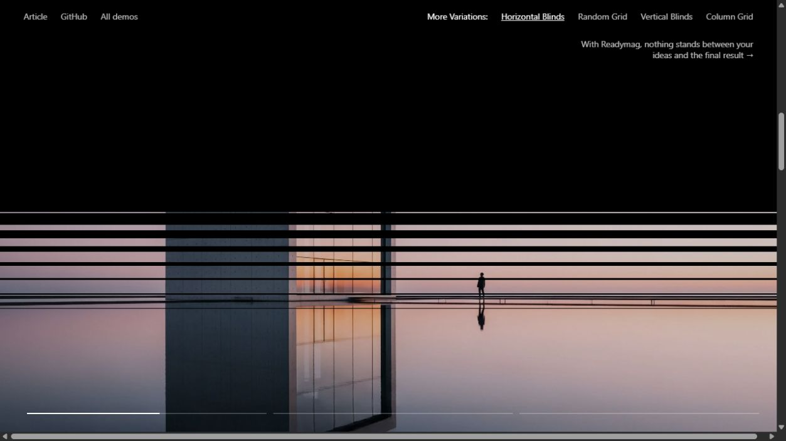

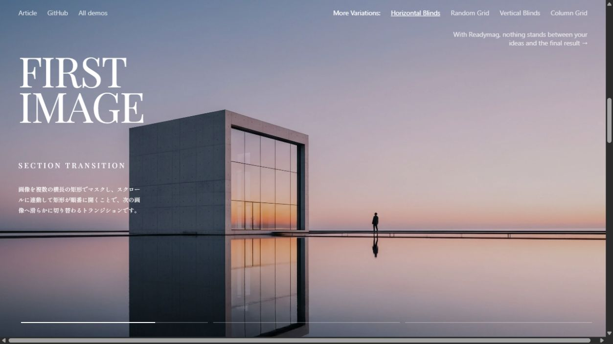

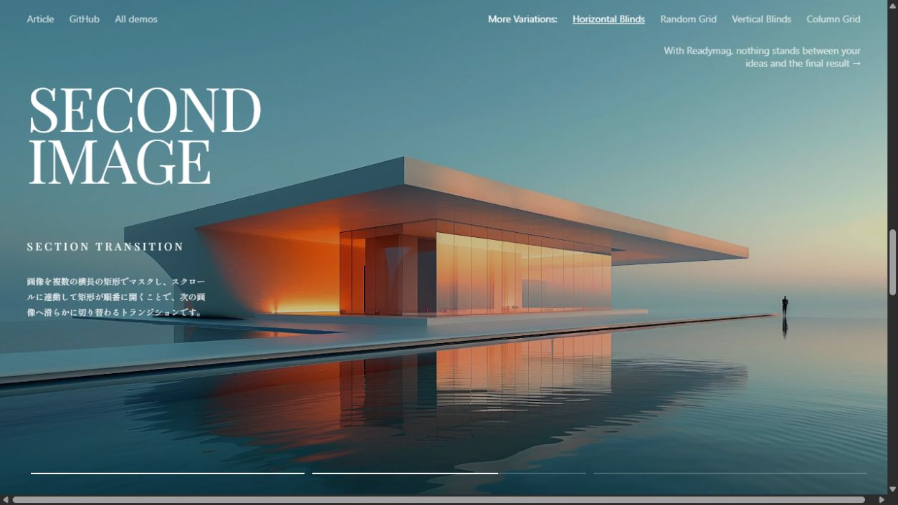

**Observed:** the image and text remain inside a stationary stage while the scroll advances. The DOM contained three masks, 183 mask rectangles and a sticky layers element, with no pin spacer. This matches three sets of 60 white rectangles plus three black base rectangles.

**Source-confirmed:** four variants use paired horizontal slits, random cells, paired vertical slits, or cells ordered by column. Only horizontal blinds was visually exercised; the other three were inspected in source. They should not be described as browser-tested.

**Interpretation:** masking makes one continuous spatial scene out of several photographs. It can suggest apertures, facade divisions or editorial cuts, but adds narrative pacing and paint work. It is a conditional later-section technique, not a default entrance for every image.

## Evidence inventory and boundaries

The 27 screenshots are in [evidence/](evidence/). [screenshots.json](evidence/screenshots.json) records their source URLs, exported JPEG dimensions and file sizes; export dimensions differ from the CSS viewport dimensions reported by the browser. [runtime-observations.json](evidence/runtime-observations.json) preserves a final DOM/style sample and console results. Earlier numerical observations are documented above because the final sample occurs at a different scroll position. [source-manifest.json](evidence/source-manifest.json) records the isolated source locations, pinned revisions and Git blob hashes.

Additional files: `oh-desktop-01-hero.jpg` / `oh-desktop-02-scroll.jpg` are the initial 905 px sequence; `oh-wide-03-studio.jpg` actually captures the studio-to-works boundary; `atelier-desktop-03-about-filled.jpg` is the second about scroll state; `atelier-mobile-03-members.jpg` shows the narrow sticky-team layout; `mask-desktop-03-progress.jpg` records progress within the first scene. Filenames are identifiers, not proof of timing.

All screenshots are research evidence from the references. They are not proposed STILLFORM assets. No source graphics, fonts, photographs or proprietary code were added to the application.

## Five most valuable principles for STILLFORM

1. **Compose with a stable grid and unequal emphasis.** Use spans, crop decisions and intervals to communicate importance. High impact, low engineering complexity.
2. **Make typography carry hierarchy before adding effects.** Distinguish display, reading and metadata roles; animate only a few meaningful entrances. High impact, low-to-medium complexity.
3. **Reveal imagery without interrupting its reading.** Start from a simple clipped reveal and small scale correction; use canvas only if pixelation belongs to the concept. High impact, medium complexity.
4. **Use one coherent sequence for each narrative moment, with sticky layout where sufficient.** Coordinate text/image phases and preserve reverse-scroll continuity; avoid independent competing effects. High impact, medium complexity.
5. **Keep editorial content native to Astro and give motion a clear lifecycle owner.** Centralize cross-section coordination, cleanup and any scroll driver; hydrate React only for actual stateful interaction. Medium direct visual impact, high enabling value, low-to-medium complexity.

These are ranked research conclusions. Font choice, palette, final grid, hero concept and signature motion remain undecided.

